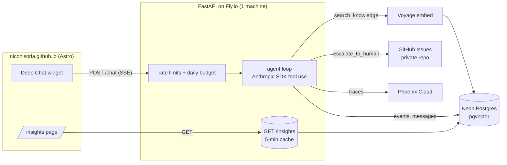

# resume-agent

A chat assistant on [niconisoria.github.io](https://niconisoria.github.io) that answers questions about Nicolas Nisoria's background, with citations. It can book a call, hand over his CV, and pass a conversation to Nicolas through a private GitHub Issues queue. Every answer is traced, evaluated in CI, and summarised on a public page.

**Live numbers:** [niconisoria.github.io/insights](https://niconisoria.github.io/insights/)

## What it does

- **Answers from a knowledge base:** retrieval over hand-written markdown (Voyage embeddings + pgvector), cited as `[n]` sources. It says when it doesn't know rather than guessing.
- **Runs skills:** `book_call` and `get_cv` return buttons rendered by the chat widget.
- **Hands off to a human:** `escalate_to_human` opens an issue in a private repo with a summary and the transcript; Nicolas replies by email.
- **Measures itself:** per-reply events (latency, tokens, cost, tool calls, topic, feedback) feed a public `/insights` page; Phoenix traces every LLM and tool call; a golden-set eval gates every deploy.
- **Stays cheap and safe:** per-IP rate limits, a 20-turn cap per chat, a daily spend cap with a graceful fallback, no IPs or emails stored in Postgres.

## Architecture



| Layer | Choice |
|---|---|
| Backend | Python 3.12, FastAPI, SSE in Deep Chat's format |
| LLM | `claude-haiku-5-5` for chat and topic labels; `claude-sonnet-5-5` as eval judge |
| Retrieval | Voyage `voyage-4` (1024 dims), Neon Postgres + pgvector (HNSW, cosine) |
| Handoff queue | GitHub Issues in a private repo, label `handoff` |
| Observability | Arize Phoenix Cloud via OpenTelemetry + OpenInference |
| Deploy | Docker on Fly.io, CI-gated by tests and evals |

Details: [docs/architecture.md](docs/architecture.md). Decision log: [docs/MEMORY.md](docs/MEMORY.md). Feature specs: [docs/specs/](docs/specs/).

## Why these choices

- **No agent framework.** Four tools and a loop capped at four rounds fit in plain Anthropic SDK code. Streaming maps directly to the widget's SSE format, traces show the real LLM and tool spans, and every step is readable in [app/agent.py](app/agent.py).
- **Fly.io, not serverless.** Rate limits live in memory, which is only correct with exactly one long-lived process. Background work after a reply (event writes, topic labels) finishes, the same image runs locally and in prod, and `Fly-Client-IP` can be trusted.
- **GitHub Issues as the handoff queue.** Open/closed state, labels and email notifications with no new account or service. The repo is private because issues hold transcripts and contact emails.

## Quality

A 25-case golden set ([evals/golden.jsonl](evals/golden.jsonl)) covers knowledge questions, tool routing, out-of-scope requests and prompt injection. CI runs it on every change to the app or evals and blocks the deploy below threshold.

| Metric | Threshold |
|---|---|
| Retrieval hit (expected source in top 5) | ≥ 0.80 |
| Tool routing | ≥ 0.90 |
| Groundedness (LLM judge) | ≥ 0.85 |
| Decline correctness (LLM judge) | ≥ 0.90 |

Latest run: [evals/REPORT.md](evals/REPORT.md). How it works: [evals/README.md](evals/README.md).

## Run locally

Needs [uv](https://docs.astral.sh/uv/) and accounts for Anthropic, Voyage, Neon, Phoenix Cloud and a GitHub fine-grained token (Issues read/write on the handoff repo).

```sh
cp .env.example .env               # fill in the values
uv sync
uv run --env-file .env python -m scripts.ingest   # apply migrations, embed knowledge/
uv run --env-file .env uvicorn app.main:app --reload
curl localhost:8000/health
```

```sh
uv run pytest                       # unit tests, no network
uv run ruff check . && uv run ruff format --check .
uv run --env-file .env python -m evals.run_evals  # live eval, spends API credits
```

Operations (deploy, secrets, limits, re-ingest, handoff triage): [docs/runbook.md](docs/runbook.md).

## API

| Method | Path | Purpose |
|---|---|---|
| POST | `/chat` | `{conversation_id?, message}` → SSE stream; final frame carries ids, citations and cards |
| POST | `/feedback` | `{message_id, rating: 1 \| -1}` |
| GET | `/insights` | 30-day aggregates, counts only |
| GET | `/health` | Liveness |

The chat widget and the insights page live in the site repo, [niconisoria.github.io](https://github.com/niconisoria/niconisoria.github.io).
