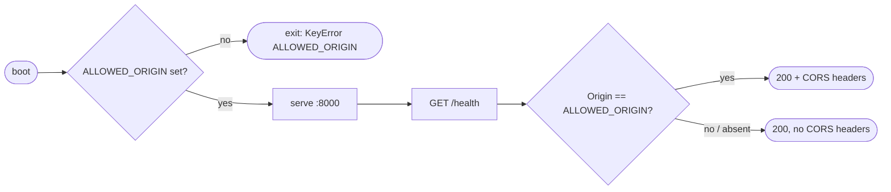

## Brainstorm

No backend exists. Need deployed FastAPI service so every later spec ships to live URL.

Scope: `config.py` env settings, `main.py` app, `GET /health` liveness only (no DB ping — Neon stays asleep), CORS for `ALLOWED_ORIGIN`, Dockerfile, `fly.toml`, first `fly deploy` to app `niconisoria-resume-agent`.

Constraints: required env = only vars used so far (S01: `ALLOWED_ORIGIN`); later specs add theirs. Missing required var → boot fails. Single always-on machine, `fra`, shared-cpu-1x 512MB. Python 3.12, uv. No `/chat`, no rate limits (S02, S03).

## Story

As owner, want deployed API skeleton, so every later feature ships to live URL.

AC:
1. `GET /health` on Fly URL returns 200
2. missing `ALLOWED_ORIGIN` → app refuses boot, error names var
3. request from `ALLOWED_ORIGIN` gets CORS headers; other origin gets none
4. single always-on machine in `fra`, 512MB; `fly deploy` succeeds
5. same Docker image runs locally, `/health` 200

## Design

Config via `os.environ` (no settings lib): missing required var raises `KeyError` naming it at import → boot fails. Local runs load `.env` with `uv run --env-file .env`. CORS via FastAPI `CORSMiddleware`, `allow_origins=[ALLOWED_ORIGIN]`. Image: `python:3.12-slim` + uv, `uv sync --frozen --no-dev`, `uvicorn app.main:app` on `0.0.0.0:8000`. Fly: `min_machines_running = 1`, `auto_stop_machines = "off"`, HTTP check on `/health`.

### Flow

### Data

input: env `ALLOWED_ORIGIN: str`
output: `GET /health` → `200 {"status": "ok"}`

### Modules

- `pyproject.toml` — add `fastapi`, `uvicorn[standard]`; dev `httpx`
- `app/__init__.py` — new, empty
- `app/config.py` — new, `ALLOWED_ORIGIN` from env
- `app/main.py` — new, app, CORS, `/health`
- `tests/test_main.py` — new, health, CORS allowed/denied, missing env fails boot
- `Dockerfile` — new
- `.dockerignore` — new, exclude `.env`, `.venv`, `.git`, `docs`, `tests`
- `fly.toml` — new, app `niconisoria-resume-agent`, `fra`, shared-cpu-1x 512MB, always on
- `AGENTS.md` — dev server command → `uv run --env-file .env uvicorn app.main:app --reload`

[config.py](app/config.py) [main.py](app/main.py) [__init__.py](app/__init__.py) [test_main.py](tests/test_main.py) [Dockerfile](Dockerfile) [.dockerignore](.dockerignore) [fly.toml](fly.toml) [pyproject.toml](pyproject.toml) [uv.lock](uv.lock) [AGENTS.md](AGENTS.md)

## Summary

FastAPI skeleton live at `https://niconisoria-resume-agent.fly.dev`, `/health` liveness only. Env read via plain `os.environ`, missing `ALLOWED_ORIGIN` kills boot with `KeyError`. CORS locked to `ALLOWED_ORIGIN`, GET/POST, `Content-Type` only. One always-on `fra` machine, shared-cpu-1x 512MB, non-root container, Fly HTTP check on `/health`.
