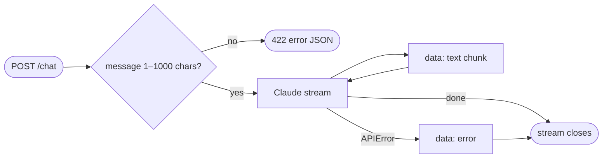

## Brainstorm

API has only `/health`. Visitor needs reply from Claude streamed token by token so chat feels live.

Scope: `POST /chat {message}` → SSE stream in Deep Chat format from `claude-haiku-5-5`, `max_tokens` 600. Stateless single turn; history comes with persistence (S07). Minimal placeholder system prompt (assistant for Nicolas's resume, third person, brief); full rules with retrieval (S08). No tools, no rate limits (S03), no widget (S05).

Constraints: body follows architecture contract (`{conversation_id?, message}`), not Deep Chat native payload — widget adapts in S05. Message > 1,000 chars or empty/missing → 4xx readable error, LLM never called. Requires `ANTHROPIC_API_KEY` at boot (Fly secret). Anthropic failure mid-stream → visitor sees readable error, not dead stream.

Related: [API Skeleton](20261021184113_api_skeleton.md)

## Story

As visitor, want send message and see reply stream in, so chat feels live.

AC:
1. message sent → reply text appears piece by piece, not all at end
2. reply speaks of Nicolas in third person, brief
3. message over 1,000 chars refused with readable error, no reply generated
4. empty or missing message refused with readable error
5. model failure → readable error shown, stream ends cleanly
6. each message answered alone, no memory of earlier ones

## Design

SSE frames per Deep Chat example server: `data: {"text": "<chunk>"}\n\n` per text delta; failure → one `data: {"error": "<readable>"}\n\n`, then stream closes. `AsyncAnthropic().messages.stream(model="claude-haiku-5-5", max_tokens=600, system=SYSTEM_PROMPT, messages=[{"role": "user", "content": message}])`, yield each `text_stream` delta. Single user message only → no memory. Validation: Pydantic body, `message` stripped, 1–1,000 chars; `RequestValidationError` handler returns `422 {"error": "<readable>"}` (Deep Chat `error` field) instead of FastAPI list detail. `ANTHROPIC_API_KEY` required in `config.py` (boot fails if missing), set as Fly secret. Errors caught: `anthropic.APIError` → generic readable message; detail logged server-side only.

### Flow

### Data

input: `POST /chat` `{ message: str, conversation_id?: uuid }`
output: `text/event-stream`, frames `{ text: str }` | `{ error: str }`; invalid input → `422 { error: str }`

### Modules

- `pyproject.toml` — add `anthropic`
- `app/config.py` — add `ANTHROPIC_API_KEY` (required)
- `app/agent.py` — new, `SYSTEM_PROMPT`, model consts, `stream_reply(message)` async generator of text deltas
- `app/main.py` — `POST /chat`, request model, SSE framing + error frame, validation error handler
- `tests/conftest.py` — new, test env (`ALLOWED_ORIGIN`, `ANTHROPIC_API_KEY`) before app import
- `tests/test_main.py` — drop inline env setup (moved to conftest)
- `tests/test_chat.py` — new, streams multiple frames, prompt says third person, 1,001 chars → 422 + model not called, empty/whitespace/missing → 422, APIError → error frame, model gets single user message

[agent.py](app/agent.py) [main.py](app/main.py) [config.py](app/config.py) [conftest.py](tests/conftest.py) [test_chat.py](tests/test_chat.py) [test_main.py](tests/test_main.py) [pyproject.toml](pyproject.toml) [uv.lock](uv.lock)

## Summary

`POST /chat` live on Fly: `claude-haiku-5-5` reply streamed as Deep Chat SSE `{"text"}` frames, stateless single turn, placeholder third-person prompt. Message stripped, 1–1,000 chars, else `422 {"error"}` without model call. Any mid-stream failure or refusal → one `{"error"}` frame, detail logged server-side only. `ANTHROPIC_API_KEY` required at boot, Fly secret.
