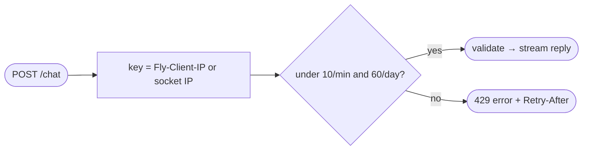

## Brainstorm

`/chat` open to anyone; one visitor can spam messages and burn Anthropic budget.

Scope: per-IP limits on `/chat` only — 10 messages/min, 60/day. Over limit → `429` with `Retry-After` and polite message saying when to retry. `/health` never limited (Fly checks). Client IP from `Fly-Client-IP`; absent (local dev, tests) → socket IP. Event logging of blocks comes with S12; call/CV fallback buttons with S09/S14.

Constraints: in-memory counters valid only because exactly one Fly machine (deploy with `--ha=false`); restart resets counts — accepted. Limit hit before model call → no spend. 429 body uses same `{"error"}` shape as other `/chat` errors.

Related: [API Skeleton](20261021184113_api_skeleton.md), [Chat Streaming](20261021200739_chat_streaming.md)

## Story

As owner, want per-visitor message limits, so one visitor can't burn budget.

AC:
1. 11th message within minute refused; first 10 answered
2. 61st message within day refused, even if spread out
3. refusal says politely when to retry, in seconds
4. refused message gets no reply generated, costs nothing
5. second visitor unaffected by first visitor's limit
6. health check never limited

## Design

`slowapi` `Limiter` (in-memory, fixed window), `key_func` = `Fly-Client-IP` header else `request.client.host`. `@limiter.limit("10/minute;60/day")` on `/chat` only — decorator runs before body handler, so no model call when over. Custom `RateLimitExceeded` handler: retry seconds from limiter window stats for exceeded limit (rounded up, min 1) → `429 {"error": "Too many messages. Please try again in N seconds."}` + `Retry-After: N`. `/health` undecorated. Tests reset limiter storage per test (autouse fixture) and fake clock for day window.

### Flow

### Data

input: header `Fly-Client-IP?: str`
output: over limit → `429 { error: str }`, header `Retry-After: int seconds`

### Modules

- `pyproject.toml` — add `slowapi`
- `app/ratelimit.py` — new, `limiter`, `client_ip(request)`, `rate_limited` handler
- `app/main.py` — register limiter + handler, decorate `/chat` (adds `request: Request` param)
- `tests/conftest.py` — autouse fixture resetting limiter storage
- `tests/test_rate_limits.py` — new, 10 ok then 11th 429, day limit with advanced clock, message + `Retry-After` seconds, model not called on 429, second IP unaffected, socket-IP fallback, `/health` unlimited

[ratelimit.py](app/ratelimit.py) [main.py](app/main.py) [conftest.py](tests/conftest.py) [test_rate_limits.py](tests/test_rate_limits.py) [test_chat.py](tests/test_chat.py) [pyproject.toml](pyproject.toml) [uv.lock](uv.lock)

## Summary

`/chat` limited per IP to 10/min and 60/day via `slowapi` fixed windows in memory; `/health` unlimited. Key = `Fly-Client-IP` (Fly proxy overwrites client-sent value — verified live) else socket IP. Over limit → `429 {"error": "...try again in N seconds."}` + `Retry-After: N`, N from limiter window reset time; model never called. Body validation runs first, so invalid messages don't consume quota.
