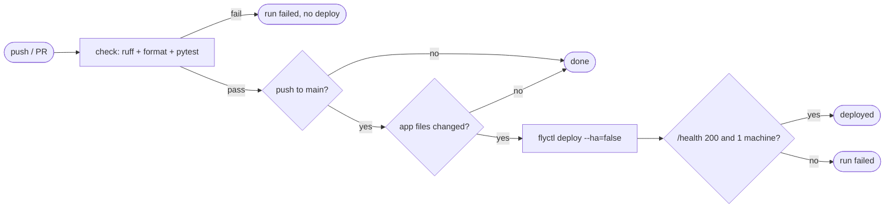

## Brainstorm

Deploys are manual `fly deploy` from laptop; nothing stops untested code reaching live app, and live app can drift from `main`.

Scope: GitHub Actions on every PR and push to `main`: `ruff check`, `ruff format --check`, `pytest`. Push to `main` that changes app files (`app/`, `Dockerfile`, `fly.toml`, `pyproject.toml`, `uv.lock`) deploys to Fly after checks pass, then smoke-checks `/health`. Docs-only pushes run checks, skip deploy. Direct pushes to `main` allowed; checks gate deploy job. Eval suite in CI comes later (S17).

Constraints: app-scoped Fly deploy token, created and stored as GitHub secret without printing. Exactly one Fly machine after every deploy. No concurrent deploys; newer push wins. Tests need no real secrets (conftest test env).

Related: [API Skeleton](20261021184113_api_skeleton.md), [Rate Limits](20261022000353_rate_limits.md)

## Story

As owner, want every push checked and app changes auto-deployed, so live app matches `main` and broken code never ships.

AC:
1. every PR and push to `main` runs lint, format check, tests; result visible on commit/PR
2. failing check → no deploy
3. push to `main` changing app files → live app updated after checks pass
4. docs-only push → checks run, no deploy
5. after deploy, live `/health` checked; not 200 → run marked failed
6. still exactly one machine after deploy
7. two quick pushes → never deploy at once; newest wins
8. no secret visible in repo or run logs

## Design

One workflow `.github/workflows/ci.yml`, triggers `pull_request` + `push` to `main`. No third-party actions beyond `actions/checkout`, `astral-sh/setup-uv`, `superfly/flyctl-actions/setup-flyctl` (all pinned).

- `check` job: `uv sync --frozen`, `ruff check .`, `ruff format --check .`, `pytest`. Test env comes from `tests/conftest.py`, no secrets.
- `deploy` job: `needs: check`, only on push to `main`. First step diffs `github.event.before..github.sha` against app paths (`app/`, `Dockerfile`, `fly.toml`, `pyproject.toml`, `uv.lock`). No match → skip remaining steps; zero/unknown `before` (first push, force push) → deploy. Then `flyctl deploy --remote-only --ha=false`, `/health` smoke check (retries, fail if not 200), machine count check (`flyctl machine list --json`, fail if ≠ 1).
- `concurrency: fly-deploy`, `cancel-in-progress: false`: running deploy finishes, queued older runs replaced by newest.
- Secret `FLY_API_TOKEN` = `fly tokens create deploy -a niconisoria-resume-agent` piped into `gh secret set` (never printed); only referenced via `secrets.` in workflow.
- Structural test parses workflow YAML so guards (`needs`, `--ha=false`, concurrency, path list, branch filter) can't silently disappear.

### Flow

### Data

input: GitHub event (`push`/`pull_request`, `before`, `sha`), secret `FLY_API_TOKEN`
output: check status on commit/PR; deployed Fly release

### Modules

- `.github/workflows/ci.yml` — new, `check` + `deploy` jobs
- `tests/test_ci_workflow.py` — new, structural assertions on workflow
- `pyproject.toml` — dev dep `pyyaml`
- `AGENTS.md` — Deploy row: CI deploys on push to `main`; manual `fly deploy --ha=false` only as fallback
