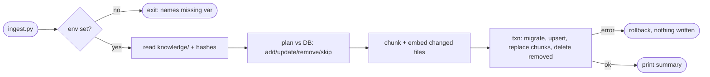

## Brainstorm

Agent has no knowledge; Neon empty. Need one command that loads `knowledge/` markdown into pgvector so retrieval (S08) can cite sources.

Scope: `migrations/001_init.sql` with all five tables from architecture (documents, chunks, conversations, messages, events), idempotent (`IF NOT EXISTS`), applied by ingest before loading. `scripts/ingest.py`: heading-based chunking per architecture "Chunking", context header per chunk, Voyage `voyage-4` 1024-dim `document` embeddings, upsert documents + chunks. 2–3 stub knowledge files derived from CV source (`../resume` `resume.en.ts`), real facts only. Run locally, manual. No retrieval/search (S08), no persistence logic (S07).

Constraints: re-run without changes → no duplicates, no re-embedding spend; edited file → old chunks replaced; deleted file → its document + chunks removed. `DATABASE_URL`, `VOYAGE_API_KEY` from `.env`; required only by ingest, not app boot. No PII in knowledge files.

Related: [API Skeleton](20261021184113_api_skeleton.md)

## Story

As owner, want one command loading `knowledge/` into database, so agent can answer from my real background.

AC:
1. one command sets up empty database and loads all knowledge files
2. each section of each file stored as searchable piece, with file title and path
3. re-run with no changes → nothing duplicated, nothing re-embedded
4. edited file → its old pieces replaced by new ones
5. deleted file → its pieces gone
6. 2–3 starter files hold real facts from my CV, nothing invented
7. command prints what it added, updated, removed, skipped
8. missing database or embedding key → clear error, nothing half-written

## Design

- `001_init.sql`: five tables per architecture data model, `IF NOT EXISTS`, `create extension if not exists vector`. `documents.path` unique; `chunks.document_id` `on delete cascade`; HNSW index `vector_cosine_ops` on `chunks.embedding`. File hash kept in `documents.metadata->>'sha256'` (no schema change).
- `ingest.py` flow: check env (`DATABASE_URL`, `VOYAGE_API_KEY`) before any I/O → read `knowledge/**/*.md` → `plan()` diff file hashes vs DB → chunk + embed only added/updated files → one transaction: apply migration, upsert documents, replace chunks, delete removed docs → commit → print summary. Any error before commit → rollback, nothing written.
- `chunk(text, title)` pure: split on `##`; file ≤ ~500 tokens (word-count estimate ≈ 375 words) → one chunk; section over limit → split on blank lines, never mid-paragraph, no overlap. Each chunk prefixed `<title> > <section>`. Title = first `# ` heading, else filename.
- `app/embeddings.py`: `embed(texts, input_type)` → Voyage REST `voyage-4`, batched; reused by S08 query embedding. HTTP via `httpx2` (declared dep, already present via `anthropic`).
- DB via `psycopg` 3; vectors passed as `'[..]'::vector` text, no extra adapter lib.
- Stubs: `knowledge/profile.md`, `knowledge/roles/vention.md`, `knowledge/skills.md` from `../resume/src/data/resume.en.ts`.

### Flow

### Data

input: `knowledge/**/*.md`, env `DATABASE_URL`, `VOYAGE_API_KEY`
output: rows in `documents` (`path`, `title`, `metadata.sha256`) + `chunks` (`content`, `embedding vector(1024)`, `position`); stdout `added N, updated N, removed N, skipped N`

### Modules

- `migrations/001_init.sql` — new, schema + HNSW index
- `app/embeddings.py` — new, Voyage `embed()`
- `scripts/ingest.py` — new, `chunk()`, `plan()`, `main()`
- `knowledge/profile.md`, `knowledge/roles/vention.md`, `knowledge/skills.md` — new stubs
- `tests/test_ingest.py` — new, chunking rules, title, plan add/update/remove/skip, missing env exits before I/O, embed failure → nothing written (fake DB + embedder)
- `pyproject.toml` — add `psycopg[binary]`, `httpx2`

[001_init.sql](migrations/001_init.sql) [embeddings.py](app/embeddings.py) [ingest.py](scripts/ingest.py) [profile.md](knowledge/profile.md) [vention.md](knowledge/roles/vention.md) [skills.md](knowledge/skills.md) [test_ingest.py](tests/test_ingest.py) [pyproject.toml](pyproject.toml) [uv.lock](uv.lock) [AGENTS.md](AGENTS.md)

## Summary

`python -m scripts.ingest` applies idempotent `001_init.sql` (5 tables, HNSW index), diffs file SHA-256 vs `documents.metadata`, chunks changed files by `##` (≤375 words whole), embeds all changed chunks in one Voyage `voyage-4` call, and replaces their chunks inside a single transaction. Unchanged files skipped without embedding; removed files deleted with cascade; any failure rolls back. Three CV-derived stubs loaded to Neon (3 docs, 1024-dim vectors). Verified live: add/update/remove/skip, real 429 rollback, simulated embed failure rollback.
