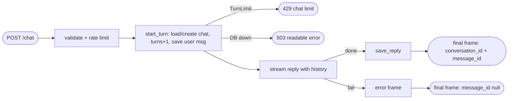

## Brainstorm

`/chat` stateless: each message answered alone, nothing stored. Agent can't follow up; analytics (S12) has no data.

Scope: persist conversations + messages in Neon tables from S06. No `conversation_id` or unknown id → new conversation, id returned. Known id → prior turns sent to model as history, from any IP. Final SSE event carries `conversation_id` + `message_id`. User message saved before model call; assistant message saved only when reply completes. Every user message counts toward 20-turn cap; turn 21 refused politely, no model call. Conversation stores `sha256(ip + IP_HASH_SALT)` only. No retrieval (S08), no event logging (S12), no widget changes (S10).

Constraints: `DATABASE_URL` + `IP_HASH_SALT` required at boot, Fly secrets. Async DB access, no blocking event loop. Rate limits + validation still run before any DB write. DB failure → readable error, never raw. Existing chat behaviour (stream frames, errors) unchanged except added final event.

Related: [Chat Streaming](20261021200739_chat_streaming.md), [Rate Limits](20261022000353_rate_limits.md), [Knowledge Ingest](20261023011959_knowledge_ingest.md)

## Story

As visitor, want assistant to remember earlier messages in my chat, so I can ask follow-ups naturally.

AC:
1. first message starts new chat; reply ends with chat id and message id
2. follow-up with chat id → answer uses earlier messages
3. unknown chat id → fresh chat started, new id returned, no error
4. chat continues after switching network
5. 21st message in one chat refused politely, no reply generated
6. failed reply not remembered, but still counts toward limit
7. my IP never stored readable
8. storage outage → readable error, not raw failure

## Design

- `app/db.py`: `psycopg_pool.AsyncConnectionPool` on `DATABASE_URL`, opened/closed in FastAPI lifespan. `prepare_threshold=None` (Neon pooled endpoint runs PgBouncer transaction mode). Two functions:
  - `start_turn(conversation_id, ip_hash, text)` — one txn: lock existing conversation (`for update`) or insert new one (unknown/absent id → new uuid); `turns >= 20` → `TurnLimit`; else `turns += 1`, insert user message, return `(conversation_id, history)` with prior messages oldest first.
  - `save_reply(conversation_id, text) -> message_id`.
- `ip_hash = sha256(ip + IP_HASH_SALT)`, IP from existing `client_ip()`.
- `/chat` endpoint awaits `start_turn` before streaming, so refusals get real status codes: `TurnLimit` → `429 {"error": "This chat reached its 20-message limit. Please start a new one."}`; DB error → `503 {"error": <readable>}`, detail logged.
- `stream_reply(message, history)`: `messages = history + [user]`. Consecutive user messages (earlier failed reply) allowed by API.
- Stream end: full reply → `save_reply` → final frame `data: {"conversation_id": ..., "message_id": ...}`. Model failure/refusal → `{"error"}` frame, nothing saved, final frame with `message_id: null` (widget keeps chat id). `save_reply` failure → logged, final frame `message_id: null`. Final frame has no `text`; widget reads it in S10.
- Order unchanged: validation → rate limit → `start_turn` → model.
- `DATABASE_URL`, `IP_HASH_SALT` required in `config.py`; set as Fly secrets before deploy.

### Flow

### Data

input: `{ message: str, conversation_id?: uuid }`, client IP
output: SSE `{text}`* then `{conversation_id: uuid, message_id: uuid | null}` (or `{error}` before it); `429/503 {error}`; rows in `conversations` (`ip_hash`, `turns`), `messages` (`role`, `content`)

### Modules

- `pyproject.toml` — add `psycopg-pool`
- `app/config.py` — require `DATABASE_URL`, `IP_HASH_SALT`
- `app/db.py` — new, pool, `start_turn`, `save_reply`, `TurnLimit`
- `app/agent.py` — `stream_reply(message, history)`
- `app/main.py` — lifespan pool, ip hash, `start_turn` before stream, final frame, 429/503 handling
- `tests/conftest.py` — test env vars, in-memory fake db fixture (autouse)
- `tests/test_persistence.py` — new, new chat ids in final frame, history passed, unknown id → new chat, other IP continues, turn 21 → 429 no model call, failed reply not saved but counted, ip stored hashed, DB down → 503
- `tests/test_chat.py` — expect trailing final frame

[db.py](app/db.py) [main.py](app/main.py) [agent.py](app/agent.py) [config.py](app/config.py) [conftest.py](tests/conftest.py) [test_persistence.py](tests/test_persistence.py) [test_chat.py](tests/test_chat.py) [pyproject.toml](pyproject.toml) [uv.lock](uv.lock)

## Summary

`/chat` persists conversations + messages in Neon via async `psycopg_pool` (lifespan-managed, `prepare_threshold=None`, 5s connect timeout). `start_turn` runs before streaming in one txn: lock-or-create chat (unknown id → new), cap 20 turns (429), count turn, save user message, return history; model gets history + new message. Non-empty full replies saved; stream always ends with `{conversation_id, message_id|null}`. IP stored only as `sha256(ip + IP_HASH_SALT)`; DB outage → 503 readable error in ~5s.
