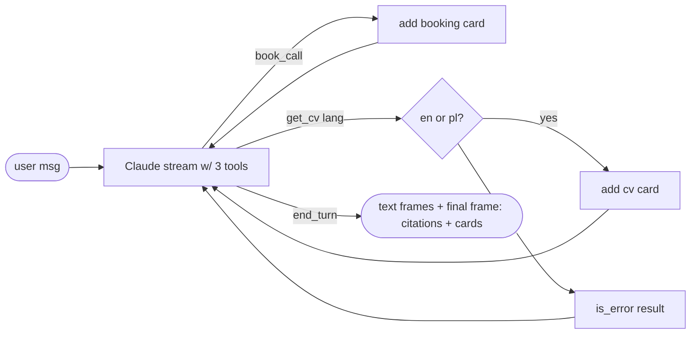

## Brainstorm

Agent offers calls and mentions CV only in text; visitor must hunt for links. Need actionable skills.

Scope: two tools beside `search_knowledge`. `book_call` (no input) → `CALENDAR_URL` as button card; used when visitor wants to talk AND whenever agent offers a call (unknown fact, out-of-scope decline). `get_cv(language: en|pl)` → designed public CV PDF (`CV_URL_EN`/`CV_URL_PL`) as download card; language = explicit request, else conversation language (Polish → `pl`, otherwise `en`). Final SSE frame adds `cards`. Routing: "can we talk?" → `book_call`; "send me the CV" → `get_cv`. No widget rendering (S10), no escalation tool (S11).

Constraints: URLs from env, required at boot (Fly secrets/env). Invalid language → tool error result, model retries or answers. Cards deduped per turn. Existing search, citations, scope rules unchanged.

Related: [Agent Knowledge Search](20261023163855_agent_knowledge_search.md), [Chat Streaming](20261021200739_chat_streaming.md)

## Story

As visitor, want to book call or get CV by asking, so I act without searching site.

AC:
1. "can we talk?" → reply with booking button
2. assistant offers call (unknown fact, off-topic) → booking button comes with offer
3. "send me the CV" → download button for English CV
4. asking in Polish or for Polish CV → Polish CV
5. each button appears once per reply, even if asked twice
6. knowledge answers, sources, declines still work as before

## Design

- `config.py`: require `CALENDAR_URL`, `CV_URL_EN`, `CV_URL_PL`. Public URLs → `fly.toml` `[env]`, not secrets.
- `agent.py`:
  - `TOOLS = [SEARCH_TOOL, BOOK_CALL_TOOL, GET_CV_TOOL]`. `book_call` input `{}`; `get_cv` input `{language: "en"|"pl"}` (enum, required).
  - Dispatch via `HANDLERS = {name: async fn(call, turn)}` replacing if-chain; unknown name → `is_error`.
  - `Turn` state per reply: `hits` (citations numbering) + `cards` (dict keyed by `(type, url)` → dedupe, first-seen order).
  - Cards: `{"type": "booking", "label": "Book a call with Nicolas", "url": CALENDAR_URL}`, `{"type": "cv", "label": "Download CV (EN|PL)", "url": CV_URL_xx, "language": "en|pl"}`.
  - Tool result text tells model the button is shown ("Booking button shown to the visitor.") so it never pastes URLs.
  - Final event `{"citations": [...], "cards": [...]}`.
- `SYSTEM_PROMPT` adds: call `book_call` whenever visitor wants to talk or you offer a call; call `get_cv` when visitor wants CV — language from explicit request, else conversation language (Polish → `pl`, otherwise `en`); never write URLs, buttons appear automatically.
- `main.py`: final frame gains `cards`.
- Routing correctness (which tool for which phrasing) is model behaviour: verified live here, guarded by evals (S16).

### Flow

### Data

input: tool calls `book_call {}`, `get_cv {language}`
output: final frame `cards: [{type: "booking"|"cv", label, url, language?}]`

### Modules

- `app/config.py` — 3 required URLs
- `app/agent.py` — tool defs, handler map, `Turn`, cards, prompt rules, final event
- `app/main.py` — `cards` in final frame
- `fly.toml` — `[env]` URLs
- `tests/conftest.py` — test env URLs
- `tests/test_skills.py` — new, booking card, cv card en/pl, invalid language → error, dedupe, cards + citations together, tool result says button shown, prompt rules, three tools offered
- `tests/test_agent.py` — tool list assertion

[agent.py](app/agent.py) [config.py](app/config.py) [main.py](app/main.py) [fly.toml](fly.toml) [conftest.py](tests/conftest.py) [test_skills.py](tests/test_skills.py) [test_agent.py](tests/test_agent.py) [test_chat.py](tests/test_chat.py) [test_persistence.py](tests/test_persistence.py)

## Summary

`book_call` and `get_cv(en|pl)` tools added via `HANDLERS` map; cards (booking, CV) collected per reply in `Turn`, deduped, sent in final frame next to citations; URLs only from env (`fly.toml [env]`), never from the model. Prompt routes talk requests and every offered call to `book_call`, CV language from request else conversation language. Live run exposed Haiku narrating its plan before tool calls; text before the first tool call is now held back and dropped when a tool follows, and tool notes tell the model when a button was already shown.
