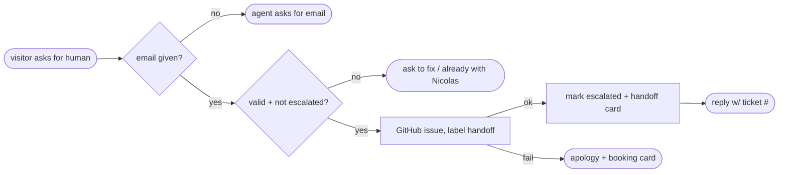

## Brainstorm

Agent can only offer a call; visitor with a question it can't answer has no way to reach Nicolas asynchronously. Need human handoff queue.

Scope: `escalate_to_human(summary, reason, contact_email)` tool. Email required: agent asks for it first, never invents one. Creates issue labelled `handoff` in private `GITHUB_HANDOFF_REPO` with summary, reason, email, full transcript. Conversation marked `escalated`; final frame gets "a human will follow up" card with issue number. One escalation per conversation; repeat → agent says it's already with Nicolas. Event logging (S12) and widget rendering (S10 site) out of scope.

Constraints: email never stored in Postgres — emails in user and assistant messages redacted (`[email]`) before saving; model still sees current message unredacted; address goes only to GitHub. Email given in an earlier turn is redacted from history, so agent asks again. GitHub API failure → polite fallback (booking card), error logged, conversation not marked. `GITHUB_TOKEN` + `GITHUB_HANDOFF_REPO` required, Fly secrets. Basic email format check.

Related: [Agent Knowledge Search](20261023163855_agent_knowledge_search.md), [Book Call and CV Skills](20261023182834_skills_call_cv.md)

## Story

As visitor, want to hand my question to Nicolas, so I get answer bot can't give.

AC:
1. ask for human follow-up → assistant asks my email if not given
2. with email → Nicolas gets private ticket with my question, reason, email, whole chat
3. reply confirms human will follow up, shows ticket number
4. asking again in same chat → told it's already with Nicolas, no second ticket
5. invalid email → asked to correct it, no ticket
6. ticket system down → polite apology + booking button, no ticket claimed
7. my email never kept in chat history storage

## Design

- `app/handoff.py`: `create_issue(title, body) -> int` via `httpx2.AsyncClient` → `POST /repos/{GITHUB_HANDOFF_REPO}/issues`, labels `["handoff"]`, 10s timeout, raises on non-2xx. `EMAIL_RE` + `redact_emails(text)` → `[email]`.
- `app/db.py`: `start_turn` also returns conversation `status`; new `mark_escalated(conversation_id)`.
- `app/agent.py`:
  - `ESCALATE_TOOL` `{summary, reason, contact_email}` all required strings; handler `_escalate` in `HANDLERS`.
  - `Turn` gains `conversation_id`, `transcript` (history + current message), `escalated`.
  - Already escalated → note "already with Nicolas", no ticket, no card. Bad email / empty or >1000-char fields → `is_error`, no ticket.
  - Success → issue body: summary, reason, email, conversation id, transcript in fenced block (backticks neutralised); `mark_escalated`; card `{"type": "handoff", "label": "Nicolas will follow up by email", "issue": n}`; note gives ticket number.
  - GitHub failure → logged, booking card added, `is_error` note "ticket system unavailable; apologise, offer booking".
  - Prompt: escalate when visitor wants Nicolas to follow up / question unanswerable and visitor wants a reply; ask email first, never invent; one per chat; mention ticket number.
  - `stream_reply(message, history, conversation_id, escalated)`.
- `app/main.py`: pass status + id to agent; `redact_emails` on user message before `start_turn` storage and on reply before `save_reply`; model gets unredacted current message.
- `app/config.py`: require `GITHUB_TOKEN`, `GITHUB_HANDOFF_REPO` (Fly secrets).

### Flow

### Data

input: `escalate_to_human {summary: str, reason: str, contact_email: str}`
output: GitHub issue (title `Handoff: 
`, body summary/reason/email/id/transcript); card `{type: "handoff", label, issue: int}`; `conversations.status = 'escalated'`; stored messages with emails → `[email]`

### Modules

- `app/handoff.py` — new, `create_issue`, `EMAIL_RE`, `redact_emails`
- `app/db.py` — status from `start_turn`, `mark_escalated`
- `app/agent.py` — tool, handler, `Turn` fields, prompt rules, signature
- `app/main.py` — pass context, redact before storage
- `app/config.py` — GitHub vars
- `tests/conftest.py` — env, FakeDB status + `mark_escalated`, fake `create_issue`
- `tests/test_handoff.py` — new, issue created with body fields + label, card + ticket note, already escalated, bad email, GitHub down → booking card, redaction in stored messages, `create_issue` HTTP call shape
- `tests/test_persistence.py`, `tests/test_agent.py`, `tests/test_skills.py` — adapt to signature

[handoff.py](app/handoff.py) [agent.py](app/agent.py) [db.py](app/db.py) [main.py](app/main.py) [config.py](app/config.py) [conftest.py](tests/conftest.py) [test_handoff.py](tests/test_handoff.py) [test_skills.py](tests/test_skills.py)

## Summary

`escalate_to_human(summary, reason, contact_email)` opens a private GitHub issue (label `handoff`, summary, reason, email, conversation id, fenced transcript), marks the conversation `escalated`, and returns a handoff card with the issue number; one ticket per chat. Agent asks for an email first; invalid email or empty fields → error note, no ticket; GitHub failure → booking card + one apology, no ticket claimed; `mark_escalated` failure after issue creation still reports success to avoid duplicate tickets. Emails redacted to `[email]` before any message is stored; model sees the live message. Verified live incl. real issue #1 (closed after test).
