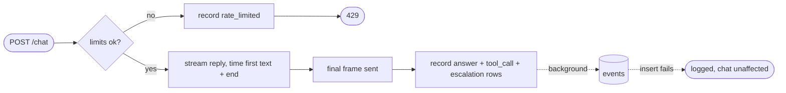

## Brainstorm

No measurement: `/insights`, daily budget (S14) and evals need per-reply numbers. `events` table exists (S06) but nothing writes to it.

Scope: write `events` rows for `answer` (one per reply: `latency_ms` total, new `first_token_ms`, `input_tokens`, `output_tokens` summed across tool rounds, `cost_usd`), `tool_call` (one per tool call, `tool_name`), `escalation` (ticket created), `rate_limited` (429 from per-IP limit or chat turn cap). `budget_exceeded` row type reserved for S14; `feedback` for S13; `topic` filled by S18. Migration `002` adds `first_token_ms`.

Constraints: writes run in background after reply; failure logged, never breaks or slows chat. Cost = Claude tokens × Haiku list price ($0.10 in / $0.50 out per MTok) as code constants; Voyage not counted. Rate-limited events have no conversation (429 before chat lookup). No IPs, emails or message text in events.

Related: [Rate Limits](20261022000353_rate_limits.md), [Knowledge Ingest](20261023011959_knowledge_ingest.md), [Agent Knowledge Search](20261023163855_agent_knowledge_search.md)

## Story

As owner, want every answer, tool use and block recorded, so I can measure speed, cost and usage.

AC:
1. each answered message recorded with total time, time to first text, tokens, cost
2. tokens and cost cover every model call in that reply, not just last
3. each tool use recorded with tool name
4. each human handoff ticket recorded
5. each refused-for-limits message recorded
6. recording failure never breaks or slows chat
7. records hold no IPs, emails or message text

## Design

- `migrations/002_first_token.sql`: `alter table events add column if not exists first_token_ms int`. `scripts/ingest.py` applies every `migrations/*.sql` in name order (was `001` only); run once to migrate Neon.
- `app/analytics.py`:
  - `HAIKU_INPUT_PER_MTOK = 0.10`, `HAIKU_OUTPUT_PER_MTOK = 0.50`, `cost_usd(input, output)`.
  - `record(rows)` → `asyncio.create_task` insert (one `executemany` per call) on `db.pool`; task refs kept in a set until done; any exception logged, never raised.
- `app/agent.py`: `Turn` accumulates `input_tokens`/`output_tokens` from each round's `final.usage`, `tools` (names of every executed tool call) and `escalation` (issue number or `None`). Final event adds `{"usage": {...}, "tools": [...], "escalated": bool}`.
- `app/main.py`: `chat_events` times reply (`perf_counter` at start, first text event, end). After final frame is built: `answer` row (only when reply completed: `latency_ms`, `first_token_ms`, tokens, `cost_usd`, `message_id`), one `tool_call` row per tool name, `escalation` row if ticket created → `analytics.record(...)`. Turn cap 429 → `rate_limited` row with `conversation_id`.
- `app/ratelimit.py`: per-IP 429 handler → `rate_limited` row (no conversation).
- Rows carry only ids, type, tool name, numbers — never text, IPs or emails.

### Flow

### Data

input: per-round `usage {input_tokens, output_tokens}`, tool names, issue number, timings
output: `events` rows — `answer {conversation_id, message_id, latency_ms, first_token_ms, input_tokens, output_tokens, cost_usd}`, `tool_call {conversation_id, tool_name}`, `escalation {conversation_id}`, `rate_limited {conversation_id?}`

### Modules

- `migrations/002_first_token.sql` — new
- `scripts/ingest.py` — apply all migrations in order
- `app/analytics.py` — new, prices, `cost_usd`, background `record`
- `app/agent.py` — usage, tools, escalation in `Turn` + final event
- `app/main.py` — timings, event rows, turn-cap event
- `app/ratelimit.py` — per-IP 429 event
- `tests/conftest.py` — fake `analytics.record` capturing rows; fake usage on model responses
- `tests/test_events.py` — new, answer row fields + summed usage + cost, tool_call rows, escalation row, failed reply → no answer row, both 429 kinds recorded, no text/IP/email in rows, `record` swallows DB errors, `cost_usd` math
- `tests/test_ingest.py` — all migrations applied in order

[analytics.py](app/analytics.py) [002_first_token.sql](migrations/002_first_token.sql) [main.py](app/main.py) [agent.py](app/agent.py) [ratelimit.py](app/ratelimit.py) [ingest.py](scripts/ingest.py) [conftest.py](tests/conftest.py) [test_events.py](tests/test_events.py) [test_ingest.py](tests/test_ingest.py)

## Summary

`events` rows written in background (`analytics.record` → task + `executemany`, errors logged, drained on shutdown): `answer` (latency, first-text time, tokens summed across tool rounds, Haiku list-price cost), `tool_call` per tool, `escalation` per ticket, `rate_limited` for per-IP 429 and chat turn cap. Caller-owned `Turn` keeps usage/tools readable after failures, so failed replies still record spend (`message_id` null). Migration `002` adds `first_token_ms`; ingest applies all migrations in order. Verified live on Neon: all four row types, cost math, no text/IP/email in rows.
