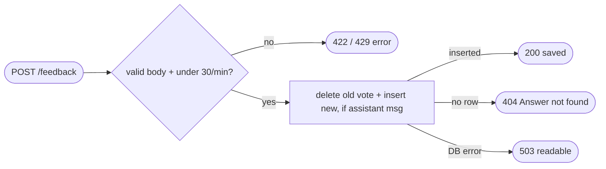

## Brainstorm

No signal on answer quality from visitors; `/insights` needs 👍 share. Final SSE frame already returns `message_id` (S07).

Scope: backend `POST /feedback {message_id, rating: 1 | -1}` → `feedback` event row (`message_id`, `conversation_id`, `rating`). Each vote stored; newest per message counts (re-vote corrects misclick). Only real assistant messages accepted: unknown or user-message id → 404. Own per-IP limit 30/min, separate from chat. Widget 👍/👎 buttons live in site repo (handoff after); insights aggregation in S18.

Constraints: CORS already allows POST from site origin. Readable `{"error"}` bodies like `/chat`. Feedback write synchronous (visitor needs confirmation it saved), DB failure → 503 readable. No text or IP in rows.

Related: [Conversation Persistence](20261023023115_conversation_persistence.md), [Event Logging](20261024010213_event_logging.md)

## Story

As visitor, want to rate an answer, so Nicolas learns what works.

AC:
1. thumbs up or down on answer saved, confirmation returned
2. changing my vote replaces earlier one
3. rating anything but real assistant answer refused
4. rating other than up/down refused with readable error
5. too many ratings per minute refused politely; chat unaffected
6. storage outage → readable error

## Design

- `db.save_feedback(message_id, rating) -> bool`: one statement — CTE deletes prior `feedback` rows for that message, then `insert into events (type, conversation_id, message_id, rating) select 'feedback', conversation_id, id, %s from messages where id = %s and role = 'assistant'`; returns whether a row was inserted. Atomic; no race between check and write. Table keeps exactly one (latest) vote per message, so S18 counts rows directly (deviation from "store each vote": same outcome, simpler queries).
- `POST /feedback`: body `FeedbackIn {message_id: uuid, rating: Literal[1, -1]}`. `@limiter.limit("30/minute")` — slowapi scopes limits per route, so chat quota untouched. Responses: `200 {"status": "saved"}`, `404 {"error": "Answer not found."}`, `503` readable on DB error, `429` via existing handler.
- Validation handler maps field → message: `message` → existing, `rating` → "Rating must be 1 (👍) or -1 (👎).", else "Invalid request.".
- Synchronous write (not `analytics.record`): visitor gets real confirmation.

### Flow

### Data

input: `{ message_id: uuid, rating: 1 | -1 }`
output: `200 {status: "saved"}` | `404/422/429/503 {error}`; one `events` row `{type: "feedback", conversation_id, message_id, rating}` per message

### Modules

- `app/db.py` — `save_feedback`
- `app/main.py` — `FeedbackIn`, `/feedback` route, field-aware validation messages
- `app/ratelimit.py` — `FEEDBACK_LIMITS = "30/minute"`
- `tests/conftest.py` — FakeDB `save_feedback` (knows assistant ids)
- `tests/test_feedback.py` — new, saved, re-vote replaces, unknown id 404, user-message id 404, bad rating 422 readable, bad uuid 422, 31st/min 429 + chat still allowed, DB down 503

[db.py](app/db.py) [main.py](app/main.py) [ratelimit.py](app/ratelimit.py) [003_feedback_unique.sql](migrations/003_feedback_unique.sql) [conftest.py](tests/conftest.py) [test_feedback.py](tests/test_feedback.py) [test_ingest.py](tests/test_ingest.py)

## Summary

`POST /feedback {message_id, rating: 1|-1}` upserts one `feedback` event per assistant message (partial unique index, migration 003) — re-vote replaces rating; unknown or user-message ids → 404. Own 30/min per-IP limit, separate from chat; feedback 429s not logged as chat blocks. Field-aware 422 messages, 503 on DB outage. Verified live on Neon incl. re-vote leaving single row.
