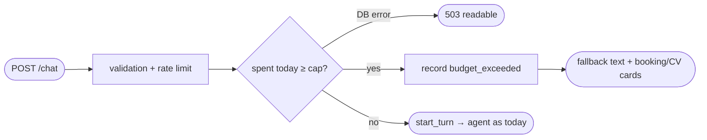

## Brainstorm

Rate limits are per IP; many IPs can still run up the Anthropic bill. Only backstop today is the Console monthly cap. Need daily spend cap in app.

Scope: before each `/chat` turn, sum today's (UTC) `cost_usd` from `events`; ≥ `DAILY_BUDGET_USD` (env, default 2) → skip model and chat lookup, stream canned "assistant resting for today" reply with booking + CV cards, final frame like normal (`message_id` null, chat id echoed). Log `budget_exceeded` event. No message stored, turn not counted. `DAILY_BUDGET_USD=0` → every message gets fallback.

Constraints: check runs after validation + rate limits. Budget query must stay cheap (index on `events.created_at`). Budget check DB failure → fail closed: 503 readable, same as storage outage (no model spend while spend unknown). Cost source = S12 `answer` rows incl. failed replies.

Related: [Event Logging](20261024010213_event_logging.md), [Rate Limits](20261022000353_rate_limits.md)

## Story

As owner, want daily spend cap, so traffic spike can't run up my bill.

AC:
1. today's spend at or over cap → visitor gets friendly "resting for today" reply instead of assistant
2. that reply comes with booking and CV buttons
3. blocked message not stored, not counted toward chat limit
4. each blocked message recorded
5. cap set to 0 → every message gets friendly reply
6. new UTC day → assistant answers again
7. spend unknown (storage down) → readable error, no assistant call

## Design

- `migrations/004_events_created_at.sql`: `create index if not exists events_created_at_idx on events (created_at)`.
- `app/config.py`: `DAILY_BUDGET_USD = float(os.environ.get("DAILY_BUDGET_USD", "2"))` — only optional setting; `fly.toml [env]` sets `"2"` explicitly.
- `app/budget.py`: `over_budget() -> bool` → `db.spent_today() >= DAILY_BUDGET_USD`.
- `app/db.py`: `spent_today()` → `select coalesce(sum(cost_usd), 0) from events where created_at >= date_trunc('day', now() at time zone 'utc') at time zone 'utc'` (start of current UTC day).
- `app/agent.py`: extract `booking_card()` / `cv_card(lang)` builders, reused by tools and fallback.
- `app/main.py` `/chat`: after validation + rate limit, before `start_turn`: `over_budget()` error → 503 readable; over → `budget_exceeded` event (`conversation_id` = sent id, may be null) + `StreamingResponse(fallback_events(...))`: one `{text}` frame "Nicolas's assistant is resting for today — book a call or grab his CV below.", final frame `{conversation_id: sent id or null, message_id: null, citations: [], cards: [booking, cv EN]}`. No model, no `start_turn`, no stored message.

### Flow

### Data

input: env `DAILY_BUDGET_USD: float` (default 2); `events.cost_usd` since UTC midnight
output: fallback SSE `{text}` + final `{conversation_id|null, message_id: null, citations: [], cards}`; event `{type: "budget_exceeded", conversation_id?}`

### Modules

- `migrations/004_events_created_at.sql` — new
- `app/config.py` — `DAILY_BUDGET_USD`
- `app/budget.py` — new, `over_budget()`
- `app/db.py` — `spent_today()`
- `app/agent.py` — `booking_card()`, `cv_card()`
- `app/main.py` — budget gate, `fallback_events`
- `fly.toml` — `DAILY_BUDGET_USD = "2"`
- `tests/conftest.py` — FakeDB `spent_today` (settable), budget env
- `tests/test_budget.py` — new, under cap → normal; at/over cap → fallback text + cards, no model call, nothing stored, turn not counted, event recorded; cap 0; chat id echoed; DB error → 503 no model call
- `tests/test_ingest.py` — migration 004 applied

[budget.py](app/budget.py) [db.py](app/db.py) [main.py](app/main.py) [agent.py](app/agent.py) [config.py](app/config.py) [fly.toml](fly.toml) [004_events_created_at.sql](migrations/004_events_created_at.sql) [conftest.py](tests/conftest.py) [test_budget.py](tests/test_budget.py) [test_ingest.py](tests/test_ingest.py)

## Summary

Before each `/chat` turn (after validation + rate limit), `over_budget()` compares today's UTC `sum(cost_usd)` (indexed, migration 004) with `DAILY_BUDGET_USD` (default 2, `fly.toml`). Over → streamed 'resting for today' reply with booking + CV cards, `budget_exceeded` event, no model call, nothing stored, turn not counted; spend unknown → 503 (fail closed). Verified live on Neon with cap 0 and default cap.
