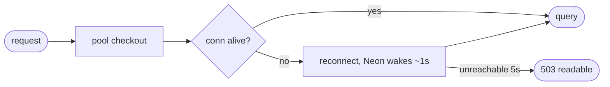

## Brainstorm

First request after Neon idles (5 min scale-to-zero) fails with 503: pool hands out connection Neon already closed (`SSL connection has been closed unexpectedly`, prod logs 2026-10-24). Next request works → chat looks broken. Scope: pool validates connections before use and recycles idle ones before Neon suspends. No retries in app code, no Neon keep-alive (would burn free compute hours).

Related: [Conversation Persistence](20261023023115_conversation_persistence.md)

## Story

As visitor, want first message after quiet period to work, so chat never looks broken.

AC:
1. first message after database slept → normal answer, no error
2. feedback after database slept → saved, no error
3. real database outage still → readable error

## Design

- `app/db.py` pool: `check=AsyncConnectionPool.check_connection` (validate on checkout, reconnect if dead) + `max_idle=240` (close idle conns before Neon's 300s suspend). Existing `timeout=5` covers cold wake (~1s).
- No retry loops; no keep-alive pings.

### Flow

### Data

input: none new
output: same responses; no 503 after idle

### Modules

- `app/db.py` — pool `check`, `max_idle`
- `tests/test_persistence.py` — pool config assertions
