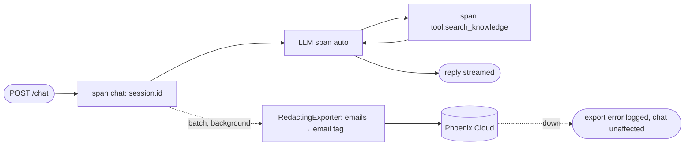

## Brainstorm

Answer quality and failures invisible: no way to inspect what model saw, which tool ran, what search returned, how long each step took. Evals (S16) also need Phoenix.

Scope: export every `/chat` request to Phoenix Cloud: LLM spans (OpenInference Anthropic instrumentation) plus tool spans (search, book_call, get_cv, escalate) nested under one per-request trace with conversation id. All requests traced. Projects: `resume-agent` (Fly) vs `resume-agent-dev` (local) via `PHOENIX_PROJECT_NAME`. Emails redacted (`[email]`) in exported span text, same rule as Postgres.

Constraints: Phoenix down or slow → chat unaffected (batch export, background). No IPs in spans. `PHOENIX_COLLECTOR_ENDPOINT` + `PHOENIX_API_KEY` as Fly secrets; missing → tracing off, app still boots (observability optional). Free tier ~25k spans/month.

Related: [Agent Knowledge Search](20261023163855_agent_knowledge_search.md), [Chat Streaming](20261021200739_chat_streaming.md)

## Story

As owner, want every chat traced in Phoenix, so I can debug answers and tool calls.

AC:
1. each chat message shows up in Phoenix as one trace with its model calls and tool steps
2. trace shows model input/output, tool inputs/results, timings, tokens
3. trace linked to chat id
4. email addresses never visible in traces; IPs never sent
5. production and local traces kept apart
6. Phoenix down or slow → chat works and stays fast
7. tracing settings missing → app still runs, just without traces

## Design

- Deps: `arize-phoenix-otel` (`phoenix.otel.register`), `openinference-instrumentation-anthropic`. Exact APIs confirmed against installed packages during implement.
- `app/tracing.py`:
  - `setup()` (called in lifespan): `PHOENIX_COLLECTOR_ENDPOINT` + `PHOENIX_API_KEY` missing → log "tracing off", return (OTel no-op tracer). Else tracer provider for project `PHOENIX_PROJECT_NAME` (default `resume-agent-dev`; `fly.toml` sets `resume-agent`), batch span processor (background thread, export failures logged, never block), `AnthropicInstrumentor().instrument(tracer_provider=...)`.
  - `RedactingExporter` wraps OTLP exporter: copies each span with string attributes passed through `redact_emails` before export.
  - `tracer = trace.get_tracer("resume-agent")`.
- `app/main.py`: `chat_events` wraps reply in root span `chat` (OpenInference kind `CHAIN`, `session.id` = conversation id, `input.value` = message, `output.value` = reply). No IP attributes.
- `app/agent.py`: `_run_tool` wraps handler in span `tool.<name>` (kind `TOOL`, `tool.name`, `input.value` = tool input JSON, `output.value` = tool result text). Anthropic SDK calls auto-instrumented as `LLM` spans (messages, tokens) nested under `chat`.
- Shutdown: lifespan flushes provider.

### Flow

### Data

input: env `PHOENIX_COLLECTOR_ENDPOINT`, `PHOENIX_API_KEY` (optional), `PHOENIX_PROJECT_NAME`
output: trace per request — `chat` (CHAIN) → `LLM` spans + `tool.*` (TOOL) spans; attributes redacted

### Modules

- `pyproject.toml` — 2 deps
- `app/tracing.py` — new, `setup`, `RedactingExporter`, `tracer`
- `app/main.py` — lifespan setup/flush, root `chat` span
- `app/agent.py` — tool spans
- `fly.toml` — `PHOENIX_PROJECT_NAME = "resume-agent"`
- `tests/test_tracing.py` — new, in-memory exporter: one trace per chat with `chat` + `tool.*` spans (fake client bypasses SDK, so LLM spans checked live), session.id, redaction of emails in exported attributes, no IP attribute, setup without env → no-op + app boots, exporter failure doesn't break chat

[tracing.py](app/tracing.py) [main.py](app/main.py) [agent.py](app/agent.py) [fly.toml](fly.toml) [pyproject.toml](pyproject.toml) [uv.lock](uv.lock) [test_tracing.py](tests/test_tracing.py)

## Summary

Every `/chat` reply is one Phoenix trace: root `chat` span (CHAIN, `session.id` = conversation id, input/output), OpenInference LLM spans (`messages.stream`, messages + tokens) and `tool.<name>` spans, plus FastAPI HTTP spans (no client IP/headers). Plain OTel provider with `RedactingExporter` (emails → `[email]` in span and event attributes) on a background batch processor; export failures logged, never block. Projects `resume-agent` (Fly) / `resume-agent-dev` (local); no Phoenix settings → tracing off. SDK's native OTel disabled to avoid double LLM spans (seen live).
