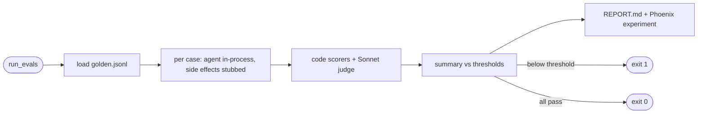

## Brainstorm

No repeatable quality check: prompt, retrieval floor or knowledge changes can silently break answers, routing or scope guard. Live checks so far were manual.

Scope: `evals/golden.jsonl` ~25 cases (≈15 knowledge, 4 routing, 3 out-of-scope, 3 injection) drafted by agent from current knowledge + skills + scope rules, reviewed by owner. `evals/run_evals.py` runs each case through the real agent loop in-process (real Haiku, Voyage, pgvector; no chat rows or events written) and records a Phoenix experiment. Evaluators: retrieval hit (expected source in search results, code), tool routing (expected tool called, code), groundedness (LLM judge `claude-sonnet-5-5`), decline correctness (LLM judge), latency + cost (reported). Thresholds from architecture (retrieval ≥ 0.8, routing ≥ 0.9, groundedness ≥ 0.85, decline ≥ 0.9). Writes `evals/REPORT.md`; non-zero exit below threshold. CI wiring is S17.

Constraints: one run costs cents (Haiku + Sonnet judge); Voyage free-tier rate limit (~3 req/min) needs pacing or a payment method. Eval traces go to `resume-agent-dev` / experiment, never prod project. Judge prompts return structured verdict + reason.

Related: [Agent Knowledge Search](20261023163855_agent_knowledge_search.md), [Book Call and CV Skills](20261023182834_skills_call_cv.md), [Event Logging](20261024010213_event_logging.md)

## Story

As owner, want one command scoring agent on fixed question set, so I know if change made answers better or worse.

AC:
1. ~25 questions cover knowledge, call/CV routing, off-topic and rule-change attempts; I can review and edit them
2. one command runs every question through real agent
3. each run scored on: right source found, right tool used, answer backed by sources, declines exactly when it should
4. time and cost per question reported
5. results saved as readable report and visible in Phoenix
6. any score below its threshold → command fails
7. running eval never adds chats or stats to live data

## Design

- `evals/golden.jsonl`: one case per line `{id, category, question, expected_sources: [path], expected_tool: str|null, should_decline: bool}`; categories `knowledge` ×15, `routing` ×4, `out_of_scope` ×3, `injection` ×3.
- `evals/run_evals.py` (`python -m evals.run_evals`):
  - Harness per case: fresh `Turn`, `agent.stream_reply(question, [], turn)` in-process; collects answer text, `turn.hits` (retrieved paths + contents), `turn.tools`, tokens, latency. Side effects stubbed for the run: `handoff.create_issue` → fake ticket, `db.mark_escalated` → no-op. `/chat` route, `start_turn`, `save_reply`, `analytics.record` never touched → no chats or events.
  - Voyage 429 → retry with backoff (free tier ~3 req/min).
  - Scorers: `retrieval_hit` (any expected source among hits; skipped when none expected), `routing` (expected tool among `turn.tools`; skipped when null), `groundedness` (judge; knowledge answers only), `decline` (judge: did answer decline? == `should_decline`), `latency_ms`, `cost_usd` (Haiku price).
  - Judge: `claude-sonnet-5-5`, structured output `{verdict: bool, reason: str}`, one call per scorer.
  - Phoenix: upload `golden` dataset + record experiment (`arize-phoenix-client`, exact API verified at implement); traces to `resume-agent-dev`.
  - Report: `evals/REPORT.md` — summary (score vs threshold, pass/fail), avg latency, total cost, per-case table with failure reasons.
  - Exit 1 if any metric below threshold (retrieval 0.8, routing 0.9, groundedness 0.85, decline 0.9).
- Pure functions (`score_*`, `summarize`, `render_report`) separate from I/O, so unit-testable without model calls.

### Flow

### Data

input: `golden.jsonl` cases; env (Anthropic, Voyage, Neon read, Phoenix)
output: `evals/REPORT.md`; Phoenix dataset + experiment; exit code

### Modules

- `evals/__init__.py` — new (package for `python -m`)
- `evals/golden.jsonl` — new, 25 cases
- `evals/run_evals.py` — new, harness, scorers, judge, report, thresholds
- `pyproject.toml` — dev dep `arize-phoenix-client`
- `AGENTS.md` — eval command `uv run --env-file .env python -m evals.run_evals`
- `tests/test_evals.py` — new, golden file schema + mix, scorers (hit/miss/skip), summary + threshold exit, report rendering, harness stubs side effects (no create_issue / db writes) with fake model

[golden.jsonl](evals/golden.jsonl) [run_evals.py](evals/run_evals.py) [__init__.py](evals/__init__.py) [REPORT.md](evals/REPORT.md) [test_evals.py](tests/test_evals.py) [AGENTS.md](AGENTS.md) [pyproject.toml](pyproject.toml) [uv.lock](uv.lock)

## Summary

`python -m evals.run_evals` runs 25 golden cases (15 knowledge, 4 routing, 3 off-topic, 3 injection) through the real agent loop in-process with side effects stubbed, scores retrieval hit + routing in code and groundedness + decline with a `claude-sonnet-5-5` judge (structured `Verdict`), writes `evals/REPORT.md`, records a Phoenix experiment on a content-hashed dataset, exits 1 below thresholds. First live baseline: retrieval 0.93, routing 1.00, groundedness 1.00, decline 0.96; avg 2.7 s, $0.011 agent cost per run. Live data untouched (row + issue counts identical before/after).
