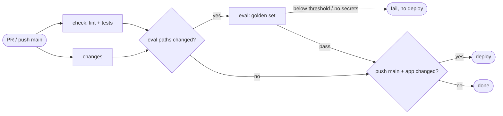

## Brainstorm

Eval suite (S16) only runs by hand; a prompt or knowledge change that breaks answers can deploy straight to prod (direct pushes to `main`).

Scope: extend existing `ci.yml` (S04). When a PR or push to `main` changes `app/` or `evals/` (or dependencies): run eval suite after lint/tests; on `main`, Fly deploy waits for eval to pass. Docs-only or unrelated changes skip eval. `REPORT.md` shown in Actions job summary every run; on PRs also one PR comment, updated in place on re-runs. Eval traces → `resume-agent-dev`.

Constraints: CI uses its own Anthropic key (separate Console workspace, low monthly cap); Voyage, Neon (read-only use) and Phoenix keys as GitHub secrets, never printed. Run ~6 min (Voyage free tier) and ~2¢. Below-threshold → job fails, deploy blocked. Eval secrets unavailable (e.g. fork PR) → job fails with explicit error, never counted as pass. `knowledge/` excluded from trigger: CI never re-ingests, so eval would score stale embeddings — ingest + eval locally after knowledge edits.

Related: [Deploy Pipeline](20261022164247_deploy_pipeline.md), [Eval Suite](20261024114509_eval_suite.md)

## Story

As owner, want every change to answers checked by eval before it ships, so broken prompt never reaches live site.

AC:
1. change to app, knowledge or evals → eval runs automatically on PR and on push to main
2. eval below threshold → run fails, live site not updated
3. eval passes → deploy goes ahead as before
4. docs-only change → no eval, no wait
5. eval results readable on every run; PRs get one comment kept up to date
6. CI spend separate from live site spend, keys never shown in logs
7. eval can't run (missing keys) → clearly reported, never counted as pass

## Design

`.github/workflows/ci.yml` gains two jobs; `deploy` keeps its flyctl, smoke and machine steps.

- `changes` job (new): diffs PR base…head (PR) or `before`…`sha` (push; unknown base → everything changed). Outputs `app` (`app/`, `Dockerfile`, `fly.toml`, `pyproject.toml`, `uv.lock` — moved out of `deploy`) and `eval` (`app/`, `evals/`, `pyproject.toml`, `uv.lock`; not `knowledge/` — no re-ingest in CI). PR diff is `base...head`; paths read null-separated.
- `eval` job (new): `needs: [check, changes]`, runs when `changes.eval == 'true'`, `timeout-minutes: 20`, `permissions: pull-requests: write`.
  1. Stale committed `REPORT.md` deleted first; then guard: required secrets missing → `::error::` + exit 1 (never a silent pass).
  2. `uv run python -m evals.run_evals` with env: `ANTHROPIC_API_KEY` ← `secrets.CI_ANTHROPIC_API_KEY`, `VOYAGE_API_KEY`, `DATABASE_URL` (read-only `ci_reader` role), `PHOENIX_COLLECTOR_ENDPOINT`, `PHOENIX_API_KEY` ← secrets; `PHOENIX_PROJECT_NAME=resume-agent-dev`; config-only vars (`ALLOWED_ORIGIN`, URLs, `IP_HASH_SALT`, `GITHUB_*`) as non-secret placeholders — eval stubs tickets, never stores.
  3. `if: always()`: `evals/REPORT.md` appended to `$GITHUB_STEP_SUMMARY`.
  4. Same-repo PR only, `if: always()`: sticky comment via `gh api` — find `github-actions[bot]` comment by hidden marker `<!-- eval-report -->`, PATCH it, else POST.
- `deploy`: `needs: [check, changes, eval]`, `if: always() && push to main && check success && changes.app == 'true' && eval in (success, skipped)`. Inline detect step removed. First step skips deploy unless run's sha is current `main` tip (eval time varies → no out-of-order deploys).
- Secrets: owner creates `CI_ANTHROPIC_API_KEY` (own Console workspace, ~$5/month cap); `VOYAGE_API_KEY`, `PHOENIX_*` piped from `.env` into `gh secret set` (never printed); `DATABASE_URL` = new read-only Neon role `ci_reader` (SELECT on `documents`, `chunks` only).

### Flow

### Data

input: GitHub event, secrets `CI_ANTHROPIC_API_KEY`, `VOYAGE_API_KEY`, `DATABASE_URL`, `PHOENIX_*`
output: job summary (REPORT.md), sticky PR comment, deploy gated on eval

### Modules

- `.github/workflows/ci.yml` — `changes` + `eval` jobs, `deploy` needs/conditions
- `tests/test_ci_workflow.py` — update deploy/changes tests; new: eval triggers on right paths, uses CI key, gates deploy, summary + sticky comment always, missing-secret guard fails, secrets only via `secrets.`
