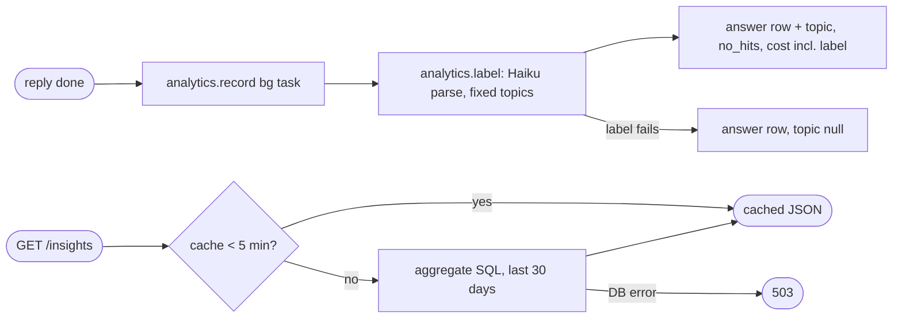

## Brainstorm

Events exist (S12–S14) but nothing aggregates them; public `/insights` page (S19) needs one JSON endpoint.

Scope: background topic label per visitor message (Haiku, fixed set: experience, skills, projects, AI work, availability, logistics, out-of-scope, other) stored on its event, plus a flag when search found nothing relevant. `GET /insights` over last 30 days: conversations + messages per day; resolution vs escalation rate; 👍 share; top topics; no-relevant-retrieval count by topic; p95 latency; cost per conversation; rate-limited + budget blocks. Cached 5 min. One-time purge of dev/test rows before launch.

Constraints: no raw text, emails, IPs or ip hashes in response. Labeling failure never affects chat (background, like event writes). Labels cost ~$0.0001/message, counted in daily spend. Failed replies (`message_id` null) excluded from resolution metrics. CORS already allows GET from site.

Related: [Event Logging](20261024010213_event_logging.md), [Answer Feedback](20261024022708_feedback.md), [Daily Budget](20261024040923_daily_budget.md), [Agent Knowledge Search](20261023163855_agent_knowledge_search.md)

## Story

As visitor, want public stats on how assistant performs, so I see it's real and measured.

AC:
1. stats cover last 30 days: chats and messages per day
2. share of chats answered without human handoff vs handed off
3. share of thumbs up among ratings
4. most asked topics from fixed list
5. how often nothing relevant was found, by topic
6. typical slow-answer time, cost per chat, messages blocked by limits or budget
7. no message text, emails or IPs ever exposed
8. stats load fast, refresh within minutes
9. dev and test traffic not counted

## Design

### Flow



### Data

label input: redacted visitor message (never stored on event).
label output: `topic` ∈ `experience | skills | projects | ai_work | availability | logistics | out_of_scope | other`.
answer row adds: `topic text`, `no_hits boolean` (= `search_knowledge` called and zero hits above floor).

`GET /insights` output:

```
{
  window_days: 30, generated_at: iso,
  days: [{ date, conversations, messages }],
  resolution: { conversations, escalated, resolved_share },
  feedback: { up, down, up_share },
  topics: [{ topic, messages, no_hits }],
  p95_latency_ms: int,
  cost_per_conversation_usd: float,
  blocked: { rate_limited, budget_exceeded }
}
```

Rules: messages = answer rows with `message_id` not null; shares null when denominator 0; counts and ids-free aggregates only.

### Modules

- `migrations/005_no_hits.sql` — `events.no_hits boolean`; index on `events (type, created_at)` if missing.
- `app/analytics.py` — `TOPICS`, `label(message)` (Haiku `messages.parse`, effort low, returns topic + cost; `None` on any error); `COLUMNS` add `no_hits`; `record(rows, message=None)` labels answer row before write; `stats()` aggregate SQL, 5-min in-memory cache.
- `app/main.py` — `_events` sets `no_hits`; pass redacted message to `record`; `GET /insights` route (503 on DB error).
- `app/ratelimit.py` — `/insights` limit `30/minute`.
- `scripts/purge_before.py` — one-time: delete events then conversations (messages cascade) created before cutoff; dry-run counts by default, `--yes` deletes. Run once with user confirmation.
- `tests/test_insights.py` — label parse/fallback, no_hits flag, aggregate shape + privacy (no text/ip keys), cache TTL, 503.
- `tests/conftest.py` — fake label client, fake stats rows.

[analytics.py](app/analytics.py) [main.py](app/main.py) [ratelimit.py](app/ratelimit.py) [005_no_hits.sql](migrations/005_no_hits.sql) [purge_before.py](scripts/purge_before.py) [test_insights.py](tests/test_insights.py) [conftest.py](tests/conftest.py) [test_events.py](tests/test_events.py)

## Summary

Background Haiku labels each answered visitor message with fixed topic before its answer row is written; label cost added to row, so daily budget counts it. Answer rows carry `no_hits` when search found nothing above floor. `GET /insights` runs three aggregate queries over 30 days, cached 5 min in memory, 503 on DB error, counts only. Dev/test rows purged once via `scripts/purge_before.py` (cutoff 2026-10-25T02:54:28Z).
